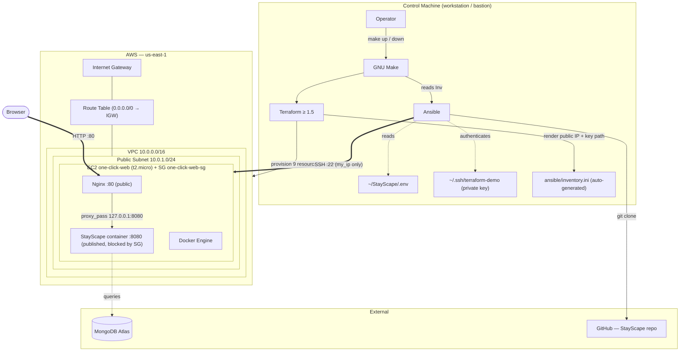
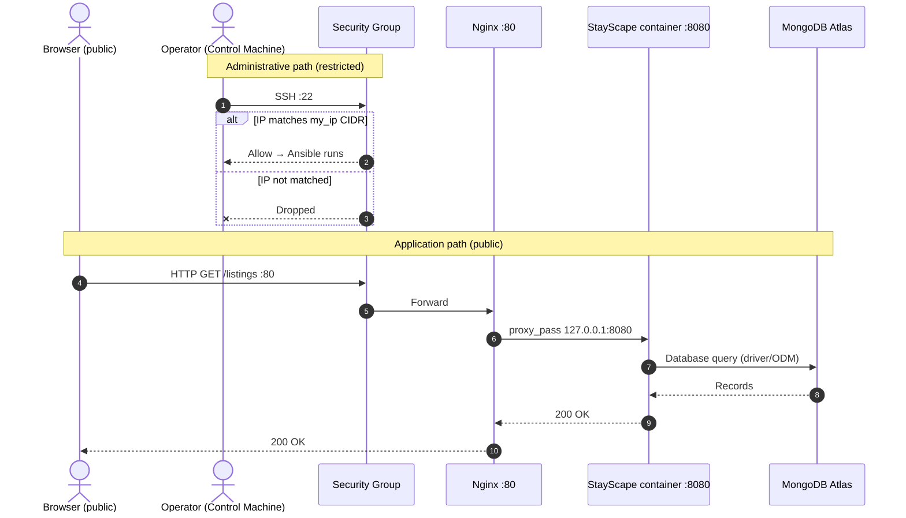
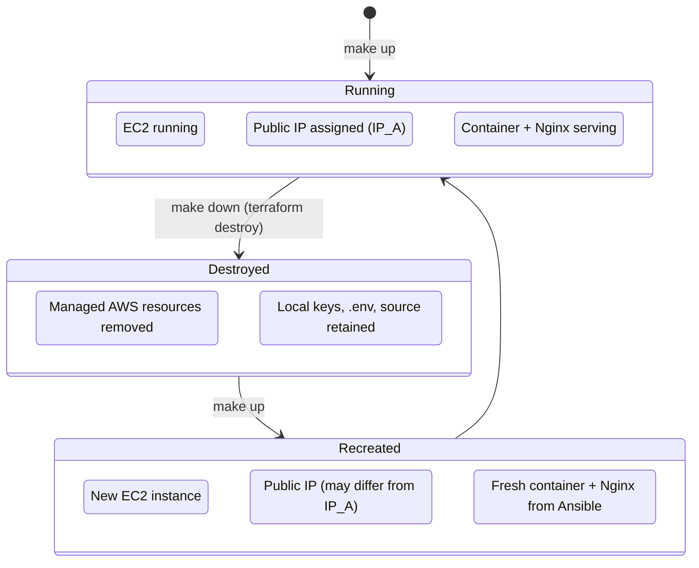

# One-Click Infrastructure — Terraform + Ansible

[](https://github.com/VaibhavSingh085/One-Click-Infrastructure-with-Terraform-Ansible/actions/workflows/validate.yml)

> One command provisions an AWS VPC + EC2 instance, configures Docker and Nginx, and deploys [StayScape](https://github.com/VaibhavSingh085/StayScape) end-to-end.
> `make up` — `make down` — done.

---

## Verified Results

| Metric | First run (`make up`) | Re-run (`make deploy`) |
|---|---|---|
| **Total wall time** | ~7 min 29 s | not measured |
| **Ansible tasks** | ok=19 changed=13 failed=0 | ok=18 changed=0 failed=0 |
| **Health checks passed** | Port 8080 ✅ Port 80 ✅ | Port 8080 ✅ Port 80 ✅ |
| **Terraform drift correction** | — | Auto-removed manually added port-8080 SG rule |
| **Environment** | `us-east-1`, `t2.micro` | same instance |

> The second `make deploy` run returned **changed=0**, confirming idempotency for all configuration tasks.
> The re-run ok count is 18 (not 19): the Nginx restart handler only fires when the vhost configuration changes, so the handler task is not counted in an unchanged re-run.
> When a port-8080 inbound rule was manually added in the AWS console, a subsequent `terraform apply` (part of `make up`) automatically removed it, demonstrating Terraform drift correction.

---

## Demo

> *Add a screen recording or GIF of `make up` terminal output and the live `/listings` page here.*

---

## System Architecture



*The security group is modelled as part of the EC2 box because it attaches directly to the instance network interface, not to the subnet.*

---

## Quick Start

```bash
# 0. Install prerequisites (once)
ansible-galaxy collection install community.docker

# 1. SSH key pair
ssh-keygen -t rsa -b 4096 -f ~/.ssh/terraform-demo
chmod 600 ~/.ssh/terraform-demo

# 2. Clone StayScape and populate secrets
git clone https://github.com/VaibhavSingh085/StayScape.git ~/StayScape
cp .env.example ~/StayScape/.env
$EDITOR ~/StayScape/.env          # fill in all six variables

# 3. Terraform variables
cp terraform/terraform.tfvars.example terraform/terraform.tfvars
$EDITOR terraform/terraform.tfvars   # set my_ip, key paths; see §Variables

# 4. Atlas allowlist — run make up first, then add the EC2 IP
#    See "MongoDB Atlas and Dynamic IPs" below for options.

# 5. Validate, then deploy
make validate
make plan
make up
# Output: Website: http://<PUBLIC_IP>/listings

# 6. Tear down when done
make down
```

> **Important — `my_ip`:** Set this to the public egress IP of the machine that *runs Terraform and Ansible* (your workstation or a bastion EC2 instance), not necessarily your laptop's IP. Confirm it with:
> ```bash
> curl -s https://checkip.amazonaws.com
> ```

---

## MongoDB Atlas and Dynamic IPs

The deploy playbook polls `http://127.0.0.1:8080/listings` for up to 60 seconds (12 × 5 s). The container must be able to reach MongoDB Atlas before that check runs, or the health check will time out and the playbook will fail.

**The timing problem:** The EC2 public IP is not known until `terraform apply` completes, so you cannot whitelist it in Atlas before the first run.

**Options, in order of preference:**

1. **During development:** Allow `0.0.0.0/0` in the MongoDB Atlas Network Access list. This is what was done during the verified test runs above. Remove the open rule when development is complete.
2. **After provisioning:** Run `make up`. When the playbook fails at the health-check step, note the public IP from the Terraform output, add it to Atlas, then re-run `make deploy`.
3. **Elastic IP (roadmap):** Adding an `aws_eip` resource to the Terraform configuration would give the instance a stable, pre-allocatable IP that survives recreations and can be permanently whitelisted in Atlas. This is not implemented in the current code — see [Future Improvements](#future-improvements).

> After `make down` / `make up` the public IP may change (dynamic allocation). Repeat whitelisting when this happens.

---

## Makefile Targets

| Target | What it runs | When to use it |
|---|---|---|
| `make validate` | `terraform init` → `terraform validate` → `ansible-playbook --syntax-check` | Smoke-test config without touching AWS |
| `make plan` | `terraform init` → `terraform plan` | Preview infra changes before applying |
| `make deploy` | `ansible-playbook site.yml` | Re-configure an already-running instance |
| `make up` | `terraform init/validate/plan/apply` → SSH poll → `ansible-playbook` → print URL | **Full lifecycle: provision + deploy** |
| `make down` | `terraform destroy` | **Destructive.** Removes all managed AWS resources |

> `make validate` checks syntax and config validity. `ansible-lint` runs only in CI.

---

## Terraform Variables

| Variable | Default | Required | Purpose |
|---|---|---|---|
| `aws_region` | `"us-east-1"` | No | AWS target region. Changing it requires updating the hardcoded AMI. |
| `vpc_cidr` | `"10.0.0.0/16"` | No | VPC network block |
| `public_subnet_cidr` | `"10.0.1.0/24"` | No | Public subnet block |
| `instance_type` | `"t2.micro"` | No | EC2 instance size |
| `ssh_public_key_path` | — | **Yes** | Path to local `.pub` file; imported into AWS Key Pairs |
| `ssh_private_key_path` | — | **Yes** | Path to local private key; used by Ansible |
| `my_ip` | — | **Yes** | Control-machine egress IP in CIDR, e.g. `203.0.113.10/32` |

`terraform.tfvars.example`:

```hcl
aws_region           = "us-east-1"
vpc_cidr             = "10.0.0.0/16"
public_subnet_cidr   = "10.0.1.0/24"
instance_type        = "t2.micro"
ssh_public_key_path  = "~/.ssh/terraform-demo.pub"
ssh_private_key_path = "~/.ssh/terraform-demo"
my_ip                = "YOUR_PUBLIC_IP/32"
```

---

## Environment File (`.env`)

Expected at `~/StayScape/.env` on the control machine. Schema from `.env.example`:

```ini
Cloud_Name=       # Cloudinary cloud name
API_Key=          # Cloudinary API key
API_Secret=       # Cloudinary API secret
MAP_TOKEN=        # Mapbox public access token
ATLASDB_URL=mongodb+srv://...   # MongoDB Atlas connection string
SECRET=           # Express session secret (use a long random string)
```

Verify the exact variable names against the [StayScape repository](https://github.com/VaibhavSingh085/StayScape) before deploying.

---

## Detailed Reference

<details>
<summary><strong>Repository layout</strong></summary>

```
.
├── .env.example
├── .gitignore
├── Makefile
├── .github/workflows/validate.yml
├── terraform/
│   ├── main.tf              # all AWS resources + local_file inventory
│   ├── variables.tf
│   ├── outputs.tf           # vpc_id, subnet_id, instance_id, public_ip, ssh_command
│   ├── inventory.tpl        # template rendered into ansible/inventory.ini
│   ├── terraform.tfvars.example
│   └── .terraform.lock.hcl  # provider locks: aws 6.68.0, local 2.9.1
└── ansible/
    ├── ansible.cfg          # inventory = inventory.ini; host_key_checking = False
    ├── inventory.ini        # generated by 'terraform apply'; excluded from git (.gitignore)
    ├── inventory.ini.example  # format reference; safe to commit
    ├── site.yml             # main deployment playbook
    └── roles/
        ├── common/tasks/main.yml   # apt update; install curl git unzip
        └── nginx/
            ├── tasks/main.yml     # install Nginx; write vhost; nginx -t; flush_handlers
            └── handlers/main.yml  # Restart Nginx
```

</details>

<details>
<summary><strong>What <code>ansible/site.yml</code> does, step by step</strong></summary>

Hosts: `web` group | Privilege escalation: `become: true`

Variables: `app_dir=/opt/stayscape`, `app_port=8080`, `app_version=main`

| # | Task | Effect |
|---|---|---|
| 1 | `common` role | `apt update`; install `curl git unzip` |
| 2 | Install packages | `docker.io git python3-docker` via apt |
| 3 | Enable Docker | `systemctl start enable docker` |
| 4 | Create app dir | `/opt/stayscape` mode `0755` |
| 5 | Clone repo | `https://github.com/VaibhavSingh085/StayScape.git` branch `main`, `force: true` |
| 6 | Copy `.env` | `~/StayScape/.env` → `/opt/stayscape/.env` mode `0600`; `no_log: true` |
| 7 | Build image | `community.docker.docker_image` builds `stayscape` from cloned source |
| 8 | Run container | `stayscape` container; ports `8080:8080`; `restart_policy: unless-stopped`; env_file |
| 9 | App health check | `GET http://127.0.0.1:8080/listings` — 12 retries × 5 s |
| 10 | `nginx` role | Install Nginx; write vhost proxying `:80 → 127.0.0.1:8080`; symlink; remove default; `nginx -t`; flush handlers |
| 11 | Proxy health check | `GET http://127.0.0.1/listings` — 6 retries × 5 s |

> The app branch is pinned to `main` (mutable). Pinning a commit hash or release tag would make builds fully reproducible.

</details>

<details>
<summary><strong>Nginx reverse-proxy configuration (inline in role)</strong></summary>

Written to `/etc/nginx/sites-available/stayscape` by the Ansible role:

```nginx
server {
    listen 80 default_server;
    listen [::]:80 default_server;

    server_name _;

    location / {
        proxy_pass http://127.0.0.1:8080;
        proxy_http_version 1.1;
        proxy_set_header Host $host;
        proxy_set_header X-Real-IP $remote_addr;
        proxy_set_header X-Forwarded-For $proxy_add_x_forwarded_for;
        proxy_set_header X-Forwarded-Proto $scheme;
    }
}
```

Port 8080 is not open in the security group; all external traffic enters on port 80 only.

> **Docker port binding note:** The playbook maps `8080:8080`, which by default binds to all host interfaces. External access is blocked at the security-group layer, not the socket layer. To restrict the bind address to loopback, change the mapping to `127.0.0.1:8080:8080` in `site.yml`.

</details>

<details>
<summary><strong>CI validation pipeline</strong></summary>

The workflow at [`.github/workflows/validate.yml`](.github/workflows/validate.yml) runs on every push and pull request. It performs **static validation only** — no AWS resources are provisioned.

**`terraform` job** (`working-directory: terraform`):
```yaml
- run: terraform fmt -check -recursive
- run: terraform init -backend=false
- run: terraform validate
```

**`ansible` job:**
```yaml
- run: pip install ansible ansible-lint
- run: ansible-galaxy collection install community.docker
- run: ansible-playbook --syntax-check ansible/site.yml
- run: ansible-lint ansible/site.yml
```

The `terraform` job sets `defaults.run.working-directory: terraform`; the Ansible job runs from the repo root. See the workflow file for the full structure.

</details>

<details>
<summary><strong>Request flow detail</strong></summary>



</details>

<details>
<summary><strong>Destroy and recreate lifecycle</strong></summary>



After recreation the public IP may change. Update the MongoDB Atlas allowlist with the new IP if not using an Elastic IP.

</details>

---

## Security Considerations

| Area | Current state | Recommendation |
|---|---|---|
| SSH access | Restricted to `my_ip` CIDR (port 22) | Keep narrow; never open to `0.0.0.0/0` |
| Web traffic | HTTP port 80, public | Add TLS (Let's Encrypt + Certbot) |
| Host-key checking | Disabled (`host_key_checking = False`) | Enable with managed `known_hosts` for production |
| Secrets at rest | Plaintext `~/StayScape/.env` on control machine | Use AWS Secrets Manager or SSM |
| Secrets in transit | Copied over SSH; `mode 0600`; `no_log: true` | This reduces exposure but is not encryption at rest |
| Terraform state | Local file | Use S3 backend + DynamoDB locking for teams |
| Container port | `8080:8080` binds all interfaces; SG blocks external access | Optionally change to `127.0.0.1:8080:8080` |
| AMI | Hardcoded `ami-080341f184b848d0b` (us-east-1 only) | Use `data "aws_ami"` for region portability |

---

## Troubleshooting

<details>
<summary><strong>Early UNREACHABLE lines during SSH polling — this is normal</strong></summary>

Immediately after `terraform apply` the EC2 instance is still booting. The Makefile polls up to 30 times (10 s apart) with `ansible web -m ansible.builtin.ping`. You will see red `UNREACHABLE` lines during this period. They are expected. The deployment continues automatically once SSH becomes available.

If the instance never becomes reachable after 5 minutes, check that `my_ip` in `terraform.tfvars` matches your current public egress IP:
```bash
curl -s https://checkip.amazonaws.com
```

</details>

<details>
<summary><strong>Missing <code>community.docker</code> collection</strong></summary>

If Ansible fails with:
```
ERROR! couldn't resolve module/action 'community.docker.docker_image'
```
Install the collection on the control machine:
```bash
ansible-galaxy collection install community.docker
```
This must be installed on the machine running Ansible (your workstation or bastion), not the target EC2 instance.

</details>

<details>
<summary><strong>Terraform corrects manual security-group edits (drift)</strong></summary>

If you manually add or modify a security-group rule in the AWS console (for example, adding port 8080 inbound for testing), Terraform will detect the drift on the next `terraform apply` and revert it to match the configuration in `main.tf`. This is expected Terraform behavior.

To avoid surprises, make all security-group changes through Terraform and apply them with `make up` or `make plan` first.

</details>

<details>
<summary><strong>SSH Permission denied (publickey)</strong></summary>

```bash
ssh -vvv -i ~/.ssh/terraform-demo ubuntu@<EC2_PUBLIC_IP>
```

Verify that `ssh_public_key_path` (`.pub`) and `ssh_private_key_path` in `terraform.tfvars` point to matching key files, and that the private key has mode `600`:
```bash
chmod 600 ~/.ssh/terraform-demo
```

</details>

<details>
<summary><strong>Application health check times out on :8080</strong></summary>

The container likely crashed at startup. Inspect logs:
```bash
ssh -i ~/.ssh/terraform-demo ubuntu@<EC2_PUBLIC_IP> "sudo docker logs stayscape"
```
Common causes: invalid `ATLASDB_URL`, missing `.env` variables, or the EC2 IP not whitelisted in MongoDB Atlas.

</details>

<details>
<summary><strong>Nginx 502 Bad Gateway</strong></summary>

```bash
ssh -i ~/.ssh/terraform-demo ubuntu@<EC2_PUBLIC_IP> \
  "sudo systemctl status nginx && sudo docker ps && sudo nginx -t"
```

A 502 usually means Nginx is running but the upstream container on port 8080 is down or unhealthy.

</details>

---

## Known Limitations

1. **Hardcoded AMI** — `ami-080341f184b848d0b` is a `us-east-1`-specific Ubuntu image. Deploying to another region requires changing this ID.
2. **HTTP only** — No TLS. Traffic is unencrypted in transit.
3. **Single instance** — No load balancer, no auto-scaling, no multi-AZ.
4. **Local Terraform state** — No remote backend; unsuitable for team use.
5. **Mutable `main` branch** — Upstream changes can produce non-reproducible builds.
6. **Dynamic public IP** — Recreating the instance may change the public IP; update Atlas allowlist accordingly.
7. **No automatic rollback** — Partial failure during `make up` leaves provisioned resources running.

---

## Future Improvements

- [ ] **Dynamic AMI** via `data "aws_ami"` (region-portable)
- [ ] **Elastic IP** — stable address across recreations; whitelist Atlas once
- [ ] **HTTPS** — Let's Encrypt + Certbot in the Nginx role
- [ ] **Remote Terraform state** — S3 + DynamoDB
- [ ] **Cloud secrets** — AWS Secrets Manager or SSM Parameter Store
- [ ] **Pinned deployments** — specific commit SHA or ECR image tag instead of `main` branch
- [ ] **SSH host-key management** — enable `host_key_checking` with `known_hosts`

---

## Author & Links

| | |
|---|---|
| **Author** | [Vaibhav Singh](https://github.com/VaibhavSingh085) |
| **Application** | [StayScape](https://github.com/VaibhavSingh085/StayScape) |
| **Infrastructure repo** | [One-Click-Infrastructure-with-Terraform-Ansible](https://github.com/VaibhavSingh085/One-Click-Infrastructure-with-Terraform-Ansible) |
